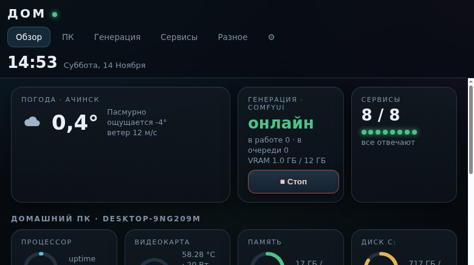

# Kiosk Dash

Домашний дашборд для планшета на стене: состояние сервера и ПК, очередь ComfyUI,
Docker-контейнеры, доступность сервисов, погода — плюс кнопки включения ПК
(Wake-on-LAN), запуска ComfyUI и перезапуска контейнеров.

Две части, обе в этом репозитории:

- **`server/`** — один файл на Python (стандартная библиотека, без зависимостей),
  отдаёт страницу и JSON-снимок метрик;
- **`android/`** — приложение-киоск: WebView на весь экран, автозапуск после
  загрузки, экран не гаснет, адрес дашборда задаётся в настройках.

**Демо без установки:** https://demodash.shkredovsv.ru — те же страницы, но данные
генерируются внутри (действия отключены).



## Быстрый старт (демо, 2 минуты)

```bash
git clone https://github.com/serya1c/dash-kiosk.git
cd dash-kiosk
docker compose -f docker-compose.demo.yml up -d --build
open http://localhost:8092
```

## Боевой режим

```bash
cp config.example.json config.json   # и поправить под себя
docker compose up -d --build
```

Дашборд слушает `:8090`. Контейнеру нужны `network_mode: host` и `pid: host`, чтобы
читать `/proc` и видеть порты хоста (Linux). Внешние библиотеки не нужны.

### `config.json`

| Поле | Что задаёт |
|---|---|
| `server.name` / `subtitle` | заголовок в шапке |
| `windows.enabled` | показывать блок ПК и ходить к нему по SSH |
| `windows.host`, `user`, `key` | адрес, пользователь и путь к SSH-ключу внутри контейнера |
| `windows.mac` | MAC для Wake-on-LAN |
| `windows.output` | каталог вывода ComfyUI (для превью генераций) |
| `windows.comfy_task` | имя задачи планировщика Windows для запуска ComfyUI |
| `weather.city`, `lat`, `lon` | город и координаты (данные: open-meteo) |
| `services[]` | список `{name, url}` для светофора доступности |
| `linux_hosts[]` | другие Linux-машины по SSH: `{name, host, user, key}` — CPU/RAM/диски/GPU/температуры |
| `demo` | `true` — генерировать данные, не читать ничего реального |

Переменные окружения переопределяют конфиг: `DASH_PORT`, `DASH_CONFIG`, `WIN_HOST`,
`WIN_USER`, `WIN_KEY`, `WIN_MAC`, `WIN_OUTPUT`, `DEMO=1`.

### Подключение Windows-ПК (необязательно)

1. На ПК включить OpenSSH Server и положить публичный ключ в
   `C:\Users\<user>\.ssh\authorized_keys`.
2. Приватный ключ примонтировать в контейнер как `/keys/win`.
3. Указать `windows.host`, `windows.user`, `windows.output`.
4. Для кнопок ComfyUI завести задачу планировщика с именем из `comfy_task`,
   запускающую `Start ComfyUI.bat`.

Сервер сам держит SSH-туннель к `127.0.0.1:8188` (ComfyUI) и `127.0.0.1:11434`
(Ollama) — на ПК ничего перенастраивать не нужно.

## Приложение-киоск (Android 7+, проверено на LineageOS 15)

Скачать APK из [Releases](../../releases) → установить → открыть → ввести адрес
дашборда (например `http://192.168.1.10:8090/`) → «Сохранить и открыть».

- запускается сам после перезагрузки (`BOOT_COMPLETED`, `MY_PACKAGE_REPLACED`);
- держит экран включённым, скрывает статусбар и навигацию;
- «назад» не выходит из дашборда, при потере сети показывает заглушку и повторяет
  подключение каждые 5 секунд;
- раз в 6 часов перезагружает страницу, чтобы WebView не копил память;
- **долгое нажатие по экрану** открывает настройки (адрес, проверка связи, демо-стенд).

В LineageOS разрешить автозапуск: *Настройки → Приложения → Kiosk Dash → Автозапуск*.

### Сборка APK

```bash
cd android
gradle assembleDebug     # JDK 17, Android SDK 35
```

В CI: `Android APK` собирает артефакт на каждый пуш, `Release APK` публикует файл
при создании тега `v*`.

## Безопасность

- Действия (`/api/action`) — жёсткий белый список: WoL, ComfyUI, именованные
  контейнеры, выбор ОС. Произвольную команду передать нельзя.
- Демо-режим блокирует все действия.
- Дашборд рассчитан на доверенную локальную сеть. **Не выставляйте его в интернет**
  напрямую — там нет авторизации; для внешнего доступа ставьте reverse-proxy с
  паролем или VPN.

## Структура

```
server/        app.py, index.html, Dockerfile
android/       Gradle-проект приложения
demo/          конфиг демо-стенда
docs/          скриншоты
.github/       CI: APK, релиз, docker-образ (ghcr.io)
```

## Ограничения

- метрики хоста читаются из `/proc` — сервер рассчитан на Linux;
- Windows-часть опциональна: без неё дашборд показывает только сервер и сервисы;
- WoL требует поддержки в BIOS (Wake on LAN / Power On By PCI-E) и выключенного
  Fast Startup в Windows.

## Лицензия

MIT — см. [LICENSE](LICENSE).
